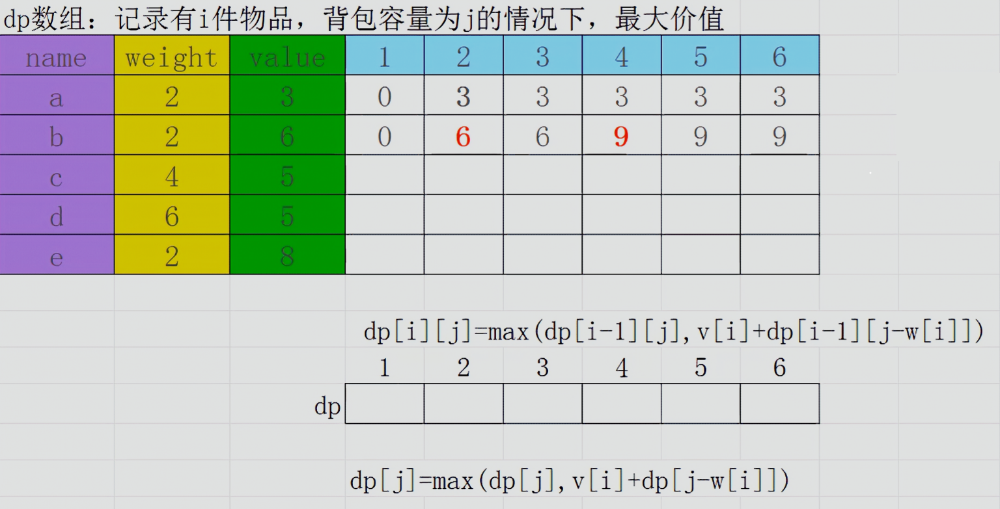

## 普通 01 背包

> **题意概要**：有 $n$ 个物品和一个容量为 $W$ 的背包，每个物品有重量 $w_i$ 和价值 $v_i$ 两种属性。要求选若干物品放入背包，使总价值最大且总重量不超过容量。

二维状态转移方程：

$$
f_{i,j} = \max\left(f_{i-1,j},\ f_{i-1,j-w_i} + v_i\right)
$$

一维状态转移方程：

$$
f_j = \max\left(f_j,\ f_{j-w_i} + v_i\right)
$$



观察二维方程和图示可以看出：每一行的数据只与上一行有关，所以可以用滚动数组把空间从 $O(nW)$ 压到 $O(W)$。

### 常见的错误写法

```cpp
for (int i = 1; i <= n; i++)
    for (int j = 0; j <= V - v[i]; j++)
        f[j + v[i]] = max(f[j] + w[i], f[j + v[i]]);
```

错在枚举顺序：容量正序枚举时，本轮刚更新的状态会被后面的转移再次使用，同一个物品被选了多次。

### 正确写法

```cpp
for (int i = 1; i <= n; i++)
    for (int j = V; j >= v[i]; j--)
        f[j] = max(f[j], f[j - v[i]] + w[i]);
```

> **注意**：务必牢记这条式子，后续背包问题的主要内容都是基于它推导出来的。

## 恰好装满时的最大价值

普通背包允许「不装满」，初始化全为 0 即可。如果要求**恰好装满**，需要把「不可达」状态显式标记为负无穷。

```cpp
#include <bits/stdc++.h>
#define int long long
#define endl '\n'
using namespace std;

const int N = 1e4 + 10;
const int INF = 1e18;

int f[N][N];   // 前 i 个物品，背包容量为 j 时的最大价值
int F[N][N];   // 记录背包恰好装满的状态
int v[N], w[N]; // 容量，价值

signed main() {
    ios::sync_with_stdio(false);
    cin.tie(0); cout.tie(0);

    int n, V; cin >> n >> V;
    for (int i = 1; i <= n; i++)
        cin >> v[i] >> w[i];

    // ============= core ===============
    for (int i = 1; i <= V; i++)
        F[0][i] = -INF;        // 容量不为 0 却什么都不选，属于不可达
    // ==================================

    for (int i = 1; i <= n; i++) {
        for (int j = 0; j <= V; j++) {
            // 不选择第 i 件物品
            f[i][j] = f[i-1][j];
            F[i][j] = F[i-1][j];

            // 选择第 i 件物品
            if (j >= v[i])
                f[i][j] = max(f[i][j], f[i-1][j-v[i]] + w[i]);
            if (j >= v[i] && F[i-1][j-v[i]] != -INF)
                F[i][j] = max(F[i][j], F[i-1][j-v[i]] + w[i]);
        }
    }

    cout << f[n][V] << endl;

    if (F[n][V] == -INF)   // 无法装满
        cout << 0 << endl;
    else
        cout << F[n][V] << endl;
}
```

## 小结

| 问题 | 容量枚举顺序 | 初始化 |
| --- | --- | --- |
| 普通 01 背包 | 倒序 | 全 0 |
| 恰好装满 | 倒序 | `f[0]=0`，其余为负无穷 |
| 完全背包 | 正序 | 全 0 |

判断依据只有一条：**容量倒序是为了让每个物品在本轮只被选一次**。
