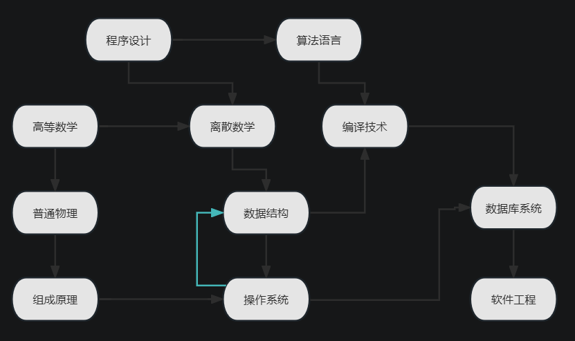
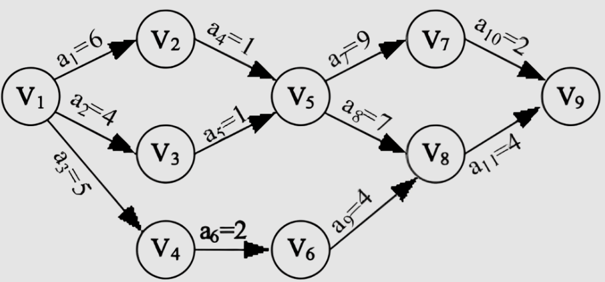

拓扑排序要求图是**有向无环图（DAG）**。核心思路：每次选择一个入度为 0 的点，然后删除这个点及其所有出边。同时出现多个入度为 0 的点时，取哪个都可以。

## AOV 网

一项大的工程可以看作若干子工程的集合，子工程之间存在先后顺序：某些子工程必须在另一些完成后才能开始。



用有向图表示子工程之间的先后关系，子工程为顶点、先后关系为有向边，这种图称为顶点活动网络，即 **AOV 网（Activity On Vertex Network）**。AOV 网必然是有向无环图，活动全部表示在顶点上。

## 关键路径与 AOE 网

与 AOV 网对应的是 **AOE 网（Activity On Edge Network）**：活动表示在边上。AOE 网是带权的有向无环图，顶点表示事件，弧表示活动持续的时间。



## Kahn 算法

**时间复杂度**：$O(V + E)$。

初始时集合 $S$ 装着所有入度为 0 的点，$L$ 是一个空列表。

每次从 $S$ 中取出一个点 $u$ 放入 $L$，然后删除 $u$ 的所有边 $(u, v_1), (u, v_2), \ldots$。若某条边删除后点 $v$ 的入度变为 0，则把 $v$ 放入 $S$。

重复以上过程直到 $S$ 为空。检查图中是否还存在边：如果存在，说明有环；否则 $L$ 中顶点的顺序就是一个拓扑序列。


上图的排序结果为：

```text
2 -> 8 -> 0 -> 3 -> 7 -> 1 -> 5 -> 6 -> 9 -> 4 -> 11 -> 10 -> 12
```

### 代码实现

```cpp
int n, m;              // 点数、边数
vector<int> G[MAXN];   // 存储边
int in[MAXN];          // 存储入度

bool toposort() {
    vector<int> L;     // 记录排序结果
    queue<int> S;      // 记录入度为 0 的点

    for (int i = 1; i <= n; i++) {
        if (in[i] == 0) {
            S.push(i);
        }
    }

    while (!S.empty()) {
        int u = S.front();
        S.pop();
        L.push_back(u);

        for (auto e : G[u]) {
            if (--in[e] == 0) {
                S.push(e);
            }
        }
    }

    if (L.size() == n) {
        for (int e : L) cout << e << " ";
        return true;
    }
    return false;
}
```

### DFS 实现

DFS 版本思路是「在回溯时把节点压栈」，时间复杂度 $O(V + E)$，空间复杂度 $O(V)$。需要注意用三色标记区分「未访问 / 访问中 / 已完成」，遇到「访问中」的节点即说明有环。

## 字典序最大 / 最小的拓扑序

把 Kahn 算法中的队列换成最小堆或最大堆即可：

```cpp
priority_queue<int, vector<int>, greater<int>> S; // 字典序最小
priority_queue<int> S;                            // 字典序最大
```

## 应用

- 判断有向图是否有环。
- 判断图是否为一条链。
- 处理带前后依赖的任务调度：完成 B 之前必须先完成 A。
- 配合 DP 在 DAG 上做状态转移。

## 习题

- [Luogu P1347](https://www.luogu.com.cn/problem/P1347)：拓扑排序模板。
- [CF 1385E](https://codeforces.com/problemset/problem/1385/E)：通过拓扑排序构造无环定向。
- [拓扑排序题单](https://www.luogu.com.cn/training/42933)
