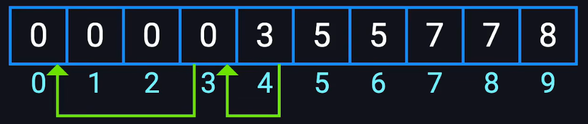
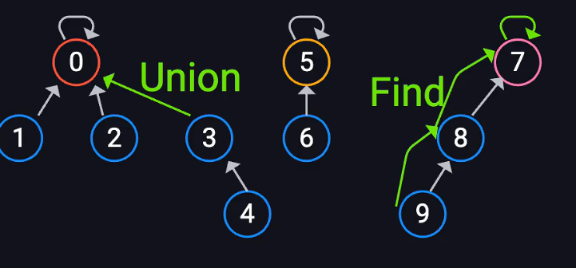

并查集（Union Find Set）用于管理元素所属的集合，实现为一个森林：每棵树代表一个集合，树中的节点代表集合中的元素。

顾名思义，它支持两种操作：

- 合并（Unite）：合并两个元素所属集合，即合并对应的两棵树。
- 查询（Find）：查询某个元素所属集合，即找到对应树的根节点，用于判断两个元素是否属于同一集合。



## 数组表示

通常用数组表示这棵树：



- 下标 `i` 的父节点就是数组中对应的值 `pa[i]`。
- 当数组的下标和值相同时，说明当前结点为根节点，即 `pa[x] == x`。

## 初始化

```cpp
vector<int> parent(n + 1);
for (int i = 0; i <= n; i++) parent[i] = i; // 将所有元素的父节点指向自己
```

## 查询 find

```cpp
int find(vector<int> &pa, const int &a) {
    // 递归查找元素 a 的父节点
    if (pa[a] != a) {
        pa[a] = find(pa, pa[a]);
    }
    return pa[a];
}
```

递归实现路径压缩后，单次查询的均摊复杂度从 $O(n)$ 降到 $O(\alpha(n))$，其中 $\alpha$ 为反阿克曼函数，实际可视为常数。

## 合并 unite

```cpp
void unite(vector<int> &pa, const int &x, const int &y) {
    int rootx = find(pa, x);
    int rooty = find(pa, y);
    if (rootx == rooty) return;
    if (Rank[rootx] > Rank[rooty]) {
        pa[rooty] = rootx;
    } else if (Rank[rootx] < Rank[rooty]) {
        pa[rootx] = rooty;
    } else {
        pa[rootx] = rooty;
        Rank[rooty]++;
    }
}
```

`Rank[]` 记录树的秩，即树的高度。**按秩合并** 与 **路径压缩** 一起使用时，均摊复杂度同样为 $O(\alpha(n))$。

## 应用

- 判断两点是否连通：`find(pa, x) == find(pa, y)`。
- 维护无向图的连通块数量：每次成功合并时连通块数减一。
- Kruskal 最小生成树中判断是否会成环。

## 习题

- [并查集题单](https://www.luogu.com.cn/training/3065#problems)
- [P3367 【模板】并查集](https://www.luogu.com.cn/problem/P3367)
- [相关视频讲解](https://www.bilibili.com/video/BV1LojAzfEoj/)
